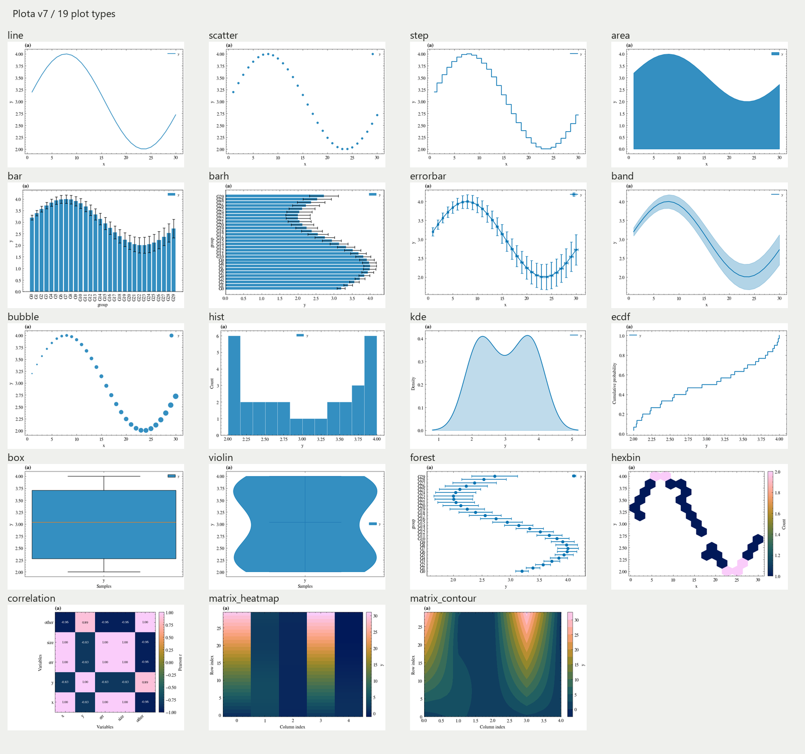
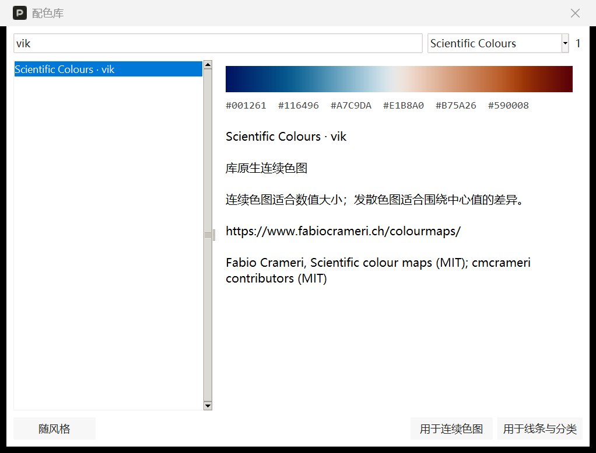

# Plota

轻量的 Windows 科研绘图桌面工具。导入数据，选择图形与风格，导出图片和可独立运行的 Python 脚本。

**[下载 Windows 单文件版](https://github.com/alyahromagnoli-create/Plota/releases/latest)** · **[完整使用说明书](docs/USER_GUIDE.md)** · **[报告问题](https://github.com/alyahromagnoli-create/Plota/issues)**


## 直接使用

1. 在 Releases 下载 `Plota.exe`，放到可写的独立文件夹，双击运行。无需安装 Python、LaTeX 或 SciencePlots。
2. 将数据文件拖入首页白色框，或点击“选择文件”。
3. 选择 X 和一个或多个 Y，选择折线/散点，点击“添加图层”。
4. 在“图形”中设置坐标和多子图，在“页面”中选择画布比例、字体与风格，然后应用。
5. 点击“导出”，同时获得 PNG、PDF、SVG、plot.py、配置和数值快照。

面向 Windows 64 位；程序会在 EXE 旁创建 `Plota_files` 保存导入副本和缓存。软件未签名，下载后可对照 Release 中的 SHA256SUMS.txt 校验。已验证本机中文空格路径单文件移动运行，未承诺所有 Windows 版本或其他操作系统兼容。

## 功能

- **22种输入扩展名**：Excel（含旧XLS）、ODS、CSV/TXT/TSV/DAT/ASC/XY/XVG、LAMMPS thermo OUT/LOG、JSON/JSONL/NDJSON、NPY/NPZ、Parquet/Feather、H5/HDF5；支持多个文件导入，`.data`不支持。
- **19种图型**：折线、散点、阶梯、面积、柱状/横向柱状、误差棒/带、气泡、直方、核密度、累计分布、箱线、小提琴、森林、六边形密度、相关矩阵、矩阵热力图/等高线。折线与散点另有线性/二次拟合。
- 多子图、跨行跨列、共享轴、对数轴、坐标范围、图例和子图编号。
- 16:9、1:1、4:3 与自定义画布；毫米尺寸、DPI和字号可调。
- 内嵌 SciencePlots 的 Science、IEEE、Nature、Bright 配置，保留经典风格。无外部 TeX 依赖。
- **1,735组离线配色**：SCI Figure Gallery 1,707组、Seaborn 6组、Scientific Colour Maps 22组。搜索、色块/HEX预览、设计解读和来源信息；分类颜色与连续色图分别应用。
- 项目 JSON 加数据快照保存；独立脚本仅依赖 NumPy 和 Matplotlib。
- Tavotto 无参数 main 入口、静态输出文件名；PDF/SVG保留可编辑图元与文字。




在“页面 → 配色”打开配色库：



## 文件怎么分享

| 目的 | 分享内容 |
| --- | --- |
| 使用软件 | 单个 `Plota.exe` |
| 展示结果 | PNG、PDF 或 SVG |
| 继续编辑项目 | 项目 JSON 和对应数据文件夹 |
| 运行 Python 或交给 Tavotto | 完整导出包，不要只发 plot.py |

在 Tavotto 中拖入导出的 `plot.py`，并按提示选择其完整文件夹。兼容测试使用 Tavotto 0.19.2 官方源码引擎；输入兼容不等于符合目标期刊的字号、栏宽或分辨率要求。

## 文档和示例

- [完整中文说明书](docs/USER_GUIDE.md)：从下载、导入、图层与布局，到项目备份、独立运行和问题排查。
- [v7新功能速查](docs/V7_FEATURES.md)：图型参数、格式布局与配色用法。
- [Excel示例表](examples/Plota_Example_Data.xlsx)：曲线、分组对比和热力矩阵三个工作表，可直接导入。分组表以“组别”为X，多选“测量A、测量B”为Y，选择柱状图。
- [曲线练习](examples/curves.csv)、[矩阵练习](examples/matrix.csv)、[LAMMPS thermo 练习](examples/demo_thermo.out)：全部为合成数据。
- Word 和 PDF 说明书在 Releases 下载。
- [第三方说明](THIRD_PARTY_NOTICES.md)。

公开包不含个人 Excel、原始研究结果或运行缓存。分享自己的项目时，数据快照和来源路径可能包含个人信息，请自行检查。

## 源码运行

建议 Windows x64 + Python 3.12（含 Tcl/Tk）：

```powershell
git clone https://github.com/alyahromagnoli-create/Plota.git
cd Plota
py -3.12 -m venv .venv
.\.venv\Scripts\python.exe -m pip install -r requirements.txt
.\.venv\Scripts\python.exe app.py
```

测试和单文件构建：

```powershell
.\.venv\Scripts\python.exe -m pip install -r requirements-dev.txt
.\.venv\Scripts\python.exe -m pytest tests -q
powershell -ExecutionPolicy Bypass -File .\build.ps1
```

输出为 `release/Plota.exe`。修改 engine.py 后，构建脚本会同步 engine_source.txt，保证冻结版本可导出同一渲染引擎。仓库不包含虚拟环境、构建缓存、用户数据和 EXE；EXE 位于 Releases。

## 版本

v7.0.0在v6基础上新增图库配色、常用统计图型、结构化数据输入和分类文字快照。85项源码测试通过，最终单文件EXE验证了全部22种扩展名导入及19种图型导出，生成的脚本仅使用NumPy/Matplotlib即可精确复现PNG。拟合为普通最小二乘；误差棒/带使用输入误差值，不自动计算置信区间。

图库来自[SCI Figure Gallery](https://github.com/Chutj/sci-figure-gallery)，分类配色来自[Seaborn](https://seaborn.pydata.org/tutorial/color_palettes.html)，连续色图来自[Scientific Colour Maps / cmcrameri](https://github.com/callumrollo/cmcrameri)。软件内嵌颜色与参考信息，不包含整套论文图片；图像取样色是近似值，不声称复现作者原始色标。

本仓库公开提供源码供查看；未为 Plota 自有代码另行指定开源许可。第三方代码、样式与字体遵循其各自许可，SciencePlots MIT 许可随配置及每个导出包保留。
