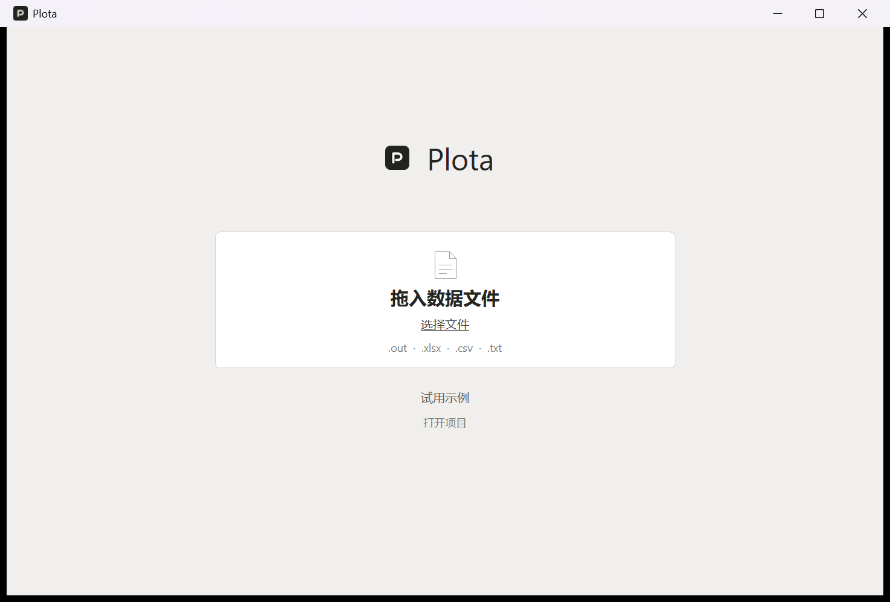
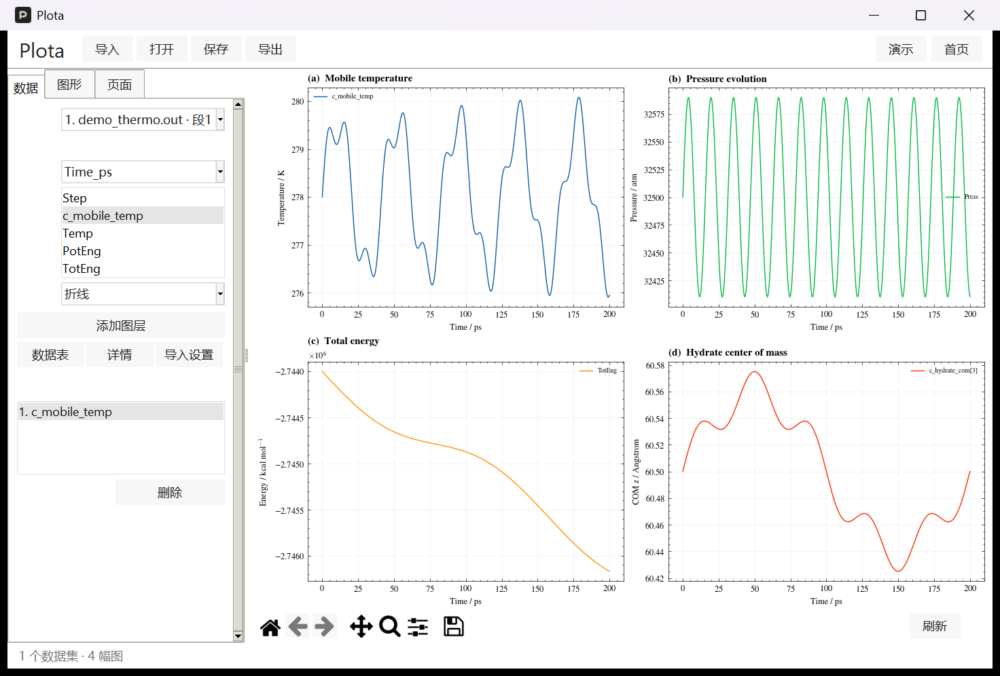
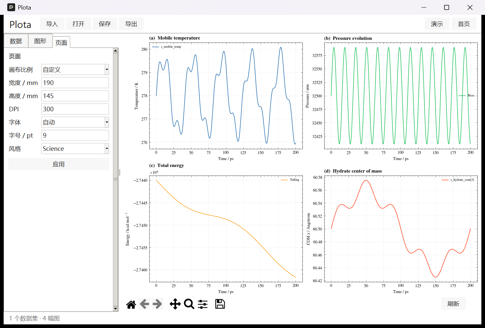
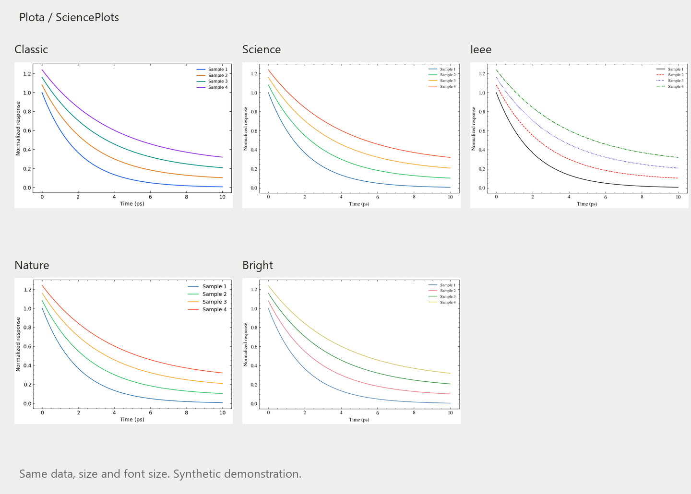

# Plota 完整使用说明书

适用版本：v6.0.0（Plota v6 首个 GitHub 公开发行版）
适用系统：Windows 64 位
说明书日期：2026年11月1日

Plota 是把数值数据转换为科研图形的桌面工具。导入表格或 LAMMPS 热力学输出后，可以选择坐标列、图形类型、颜色、拟合方式和多子图布局，预览结果，并导出 PNG、PDF、SVG 及可独立运行的 Python 绘图脚本。本说明书按实际操作顺序介绍各项功能，也说明哪些文件需要一起保存、分享或交给 Tavotto。

公开发行版的内置演示与 examples 目录均为合成数据，仅用于操作练习，不代表真实实验或模拟结果。

## 目录

1. 下载与启动
2. 五分钟完成第一张图
3. 界面与工作方式
4. 数据文件与导入设置
5. LAMMPS 输出绘图
6. 曲线 散点与拟合
7. 热力图与等高线
8. 多子图与坐标设置
9. 页面尺寸与 SciencePlots 风格
10. 保存项目与继续编辑
11. 导出图片和 Python
12. 在 Tavotto 中继续编辑
13. 文件分享与备份
14. 常见问题
15. 数据处理边界与版本说明
16. 从源码运行与打包

## 1 下载与启动

从 [GitHub Releases](https://github.com/alyahromagnoli-create/Plota/releases) 下载 `Plota.exe`。如果只想直接使用软件，不需要下载源码，也不需要安装 Python、SciencePlots 或 LaTeX。

把 EXE 放到一个可写的独立文件夹，例如 `D:\Tools\Plota\`，然后双击。不要直接在压缩包预览窗口里运行，也尽量避免放在需要管理员权限的程序目录。首次启动包含单文件解压和字体初始化，可能比之后启动稍慢。

启动后，程序会在 EXE 旁创建 `Plota_files`，用于保存导入文件副本和运行缓存。程序可以离线进行数据导入、绘图和导出。下载、安装 Python 依赖等外部操作另需网络。

EXE 面向 Windows 64 位系统，已在当前 Windows 环境完成单文件移动运行验证；没有承诺兼容所有 Windows 版本，未实测 macOS、Linux、Windows ARM 或另一台实体电脑。



## 2 五分钟完成第一张图

1. 双击 `Plota.exe`。第一次熟悉功能时，可以点击首页“试用示例”。
2. 要用自己的文件，点击“选择文件”，或把一个或多个受支持的数据文件拖到首页白色导入框内。
3. 进入编辑器后，在“数据”页的“文件”下拉框中选择数据集。
4. 设置 X 列，在“Y · 多选”中选择一列或多列。按住 Ctrl 可选不相邻的列，按住 Shift 可连续选择。
5. 类型选“折线”或“散点”，点击“添加图层”。导入数据与添加图层是两个步骤，导入后不会自动把所有列都画出来。
6. 在“页面”中选择画布比例、宽度、DPI、字体、字号与风格，点击“应用”。
7. 点击顶部“导出”，选择父文件夹。程序会新建独立导出包，里面同时包含图像、脚本、配置和数据快照。

可以下载仓库中的 [曲线练习文件](../examples/curves.csv)。选择 `time` 作为 X、`A` 和 `B` 作为 Y，即可绘制两条曲线。

“试用示例”或编辑器顶部“演示”会替换当前工作内容；打开其他项目也会切换当前工作。切换前请先保存正在编辑的项目。

## 3 界面与工作方式

首页只提供数据导入、示例和打开项目。文件导入后才显示编辑器。编辑器左侧有“数据”“图形”“页面”三页，右侧为图形预览。

| 入口 | 用途 |
| --- | --- |
| 导入 | 选择一个或多个数据文件 |
| 打开 | 打开之前保存的项目 JSON |
| 保存 | 保存项目配置及全部已导入数据的快照 |
| 导出 | 生成图像和独立 Python 复现包 |
| 演示 | 用内置合成数据建立四联图 |
| 首页 | 返回起始页，保留当前内存中的工作 |
| 数据页 | 选文件与坐标列、增加或删除图层、查看数据和提示 |
| 图形页 | 管理子图位置、标题、坐标、图例及共享轴 |
| 页面页 | 设置画布、DPI、字体和整体风格 |

参数调整后，需要点击对应区域的“应用”。选择图层或子图时，只会切换编辑对象，不会把同样设置自动应用给所有对象；切换整体风格是例外，见第9节。

预览下方使用 Matplotlib 工具栏，可回到初始视图、前进后退、平移和框选缩放。工具栏用于检查图形；要让范围稳定地写入导出包，请在“图形”页填写 X/Y 范围并应用。正式导出以当前项目配置重新渲染，不保证保存工具栏临时缩放或平移的状态。



## 4 数据文件与导入设置

### 4.1 支持的文件

| 文件 | 读取方式与限制 |
| --- | --- |
| `.xlsx`、`.xlsm` | 每个非空工作表分别作为数据集读取；不执行宏 |
| `.csv`、`.txt`、`.tsv` | 按分隔符读取数值表，支持有表头或无表头 |
| `.out`、`.log` | 按 LAMMPS 的 Step 开头 thermo 数值表读取，不是任意文本输出解析器 |
| `.xls` | 当前读取器不支持，请先在 Excel 中另存为 `.xlsx` |
| `.data` | 不支持；这是 LAMMPS 结构数据，不是本版绘图入口 |
| `.py` | 不能作为数据导入；Plota 生成 Python，Tavotto 才接收生成的绘图脚本 |

文件选择窗口主要显示 `.xlsx`、`.xls`、`.csv`、`.txt`、`.out`；读取器支持的 `.xlsm`、`.tsv`、`.log` 也可以通过首页拖放导入。选择窗口显示 `.xls` 不代表能够读取旧 Excel 二进制格式。

导入多个文件时，可在文件选择窗口多选，或将多个文件一起拖进首页白色导入框。请拖文件本身；拖文件夹不受支持。拖放识别区在首页导入卡片内，编辑器中可以使用顶部“导入”，或先返回首页再拖入。

### 4.2 建议的数据组织

曲线或散点采用“一列一个变量，一行一组观测值”的方式。例如：

```text
time,A,B
0,1.0,1.0
1,0.8,0.9
2,0.6,0.7
```

建议在第一行使用清楚、互不重复的列名。不要把标题、单位说明和数据混排在同一数值区域；单位可放进列名，或之后填写坐标轴名称。纯文本中，以 `#` 开头的整行注释和空行会跳过；不要在数值记录尾部追加未分隔的文字说明。

### 4.3 导入设置

在编辑器“数据”页点击“导入设置”。这些设置用于之后的导入，不会重新解析已经导入的数据；修改后请重新导入文件。需要先进入编辑器才能打开该窗口，可以先使用示例进入。

| 设置 | 用法 |
| --- | --- |
| 表头 `auto` | 第一条候选记录全部为数值时按无表头读取，否则按第一行表头读取 |
| 表头 `none` | 不使用表头，列名自动为 Column_1、Column_2 等 |
| 表头数字 | 从0开始选择表头行；`0` 是首行，`1` 是第二行 |
| 跳过行数 | 先跳过文件前 N 行，再按表头规则解析；不得为负数 |
| 分隔符 `auto` | 尝试逗号、分号和制表符；识别不到时尝试空白分隔 |
| 指定分隔符 | 可选逗号、tab、whitespace、分号或竖线 |
| 编码 `auto` | 依次尝试 UTF-8 含 BOM 和 GB18030；乱码时可以手动指定 |

对于文本表，空行和整行注释在跳过行数之后被过滤，因此数字表头对应过滤后的候选记录。Excel 的表头序号对应跳过行数后的工作表行。分隔符不影响 Excel；LAMMPS `.out/.log` 使用自身格式解析，表头和分隔符设置不会改变其 thermo 识别规则。

### 4.4 检查读取结果

导入后先看行列数量，点击“数据表”查看前100行，点击“详情”查看数据来源、时间换算和警告。纯文本的记录列数不一致会报错，避免字段静默错位。

完全不能转为数值的列会被排除。部分单元格不能转为数值或为空时保留为 NaN；折线在缺失点处断开，不会自动补点或插值。重复列名、空数据或没有数值列可能导致导入失败。Excel 如果只含公式且没有可读取的缓存值，建议在 Excel 中重新计算并保存，或另存为纯数值 CSV 后导入。

原始文件不会被直接写回。导入副本保存在 `Plota_files/imported/` 下；项目保存和导出还会生成各自独立的数据快照。

## 5 LAMMPS 输出绘图

### 5.1 所需格式

本版读取 `thermo one/custom` 一类以 `Step` 开头的单行表头和数值记录。例如：

```text
Unit style : real
Time step : 0.1
Step Temp TotEng Press
0 278 -2744000 32500
5000 279 -2744100 32520
10000 278.5 -2744200 32490
Loop time of 1 on 1 procs for 10000 steps with 1000 atoms
```

文件必须含可识别的 thermo 数值表。多行格式、原子坐标 dump、自定义非数值输出及任意命名为 `.out` 的文件，不保证可读取。数值行列数必须与本段表头一致；无法识别的内容可能报出行号，不能把错误提示当作完整有效数据已导入。

多段 thermo 表通常拆成不同数据集。重复表头、单元制或步长信息变化会分段，软件不会自动拼成连续时间序列。请选择正确段落作图，并核对每段行数和详情。

### 5.2 Time_ps 换算

当文件明确说明 `real` 单元制时，原始时间单位为 fs。存在 `Time` 列时，按 `Time / 1000` 生成 `Time_ps`；否则，仅在识别到有效步长时，按下式换算：

```text
Time_ps = Step × timestep_fs / 1000
```

例如步长为 `0.1 fs`、Step 为 `2,000,000`，得到 `200 ps`。缺少可靠单元制或步长时，不会凭空生成时间轴，可直接选择 Step。

重置 Step 或改变步长后，`Step × 步长` 不等于跨运行连续累计时间。软件不会自动推断偏移量；需要连续时间时，应先根据实际模拟过程整理时间列，再导入绘图。

### 5.3 操作示例

拖入仓库 [demo_thermo.out](../examples/demo_thermo.out)，在“文件”中选择对应段，X 选择 `Time_ps`，Y 选择 `c_mobile_temp`，类型选择“折线”，点击“添加图层”。然后在“图形”页填写 X 名称 `Time / ps`、Y 名称 `Temperature / K` 并应用。公开演示数据是合成的，单位与变量含义仅用于展示读取和排版流程。

## 6 曲线 散点与拟合

### 6.1 添加与编辑图层

一个图层对应一组 X/Y 曲线或一张矩阵图。同一子图可以叠加多个图层，也可以让多个图层来自不同文件。先在“图形”页选择目标子图，再到“数据”页选文件与坐标列并添加。

选择图层列表中的条目，点击“样式”打开编辑窗口。可以修改图例文字、颜色、线宽、线型、标记、标记大小、拟合方式，以及矩阵专用参数。修改后点击窗口中的“应用”。删除图层只影响当前图形，不会删除原始数据文件。

| 参数 | 说明 |
| --- | --- |
| 颜色 | 使用颜色代码或“选色”；按当前图层保存 |
| 线宽 | 必须大于0，导出时使用同一设置 |
| 线型 | 实线 `-`、虚线 `--`、点划线 `-.`、点线 `:` |
| 标记 | 可选圆点、方形、三角、菱形、叉号等；折线可选“无” |
| 标记大小 | 必须大于0；散点使用对应大小的平方作为面积参数 |
| 图例 | 改变这一图层的显示名称，不会改写数据列名 |

### 6.2 拟合

在图层样式中选择“线性拟合”或“二次拟合”。原始数据仍显示，另叠加虚线拟合曲线；图例包含多项式系数和 R²。

线性模型为 `y = a1 × x + a0`，二次模型为 `y = a2 × x² + a1 × x + a0`。线性拟合至少需要2个不同 X 值，二次至少需要3个；计算仅使用 X 和 Y 同时为有限值的记录。

这里使用普通最小二乘多项式拟合，不含误差权重、置信区间、异常值剔除或因果判断。R² 不能代替模型合理性检查；所有 Y 相同等情况下可能没有有效 R²。拟合是在原始数值坐标中进行，打开对数轴不会自动改成对数回归。

## 7 热力图与等高线

### 7.1 数据含义

热力图和等高线将选定数据区域直接视为二维数值矩阵：数据行对应 Y 方向，数据列对应 X 方向。横纵坐标默认是列索引和行索引，使用等间距网格，不会自动把三个字段 X/Y/Z 解释成空间坐标，也不会自动进行散乱点插值。

练习时可以导入 [matrix.csv](../examples/matrix.csv)。它的第一行也是数值，因此表头使用 `auto` 或 `none` 即可。在“类型”中选“矩阵热力图”或“矩阵等高线”，再点击“添加图层”。这两种图不依赖普通曲线的 X/Y 列选择。

### 7.2 选择矩阵区域

在图层“样式”窗口填写起始/终止行列。这里使用从0开始、不含终止位置的范围；全部留空表示整个数值矩阵。

例如“起始行0、终止行10、起始列2、终止列8”读取前10行和第3至第8列，最终矩阵为10行6列。此处索引针对导入后实际保留的数值矩阵，不含已去除的表头和非数值列。有效区域至少为2×2，且必须有有限数值。

### 7.3 色图与色标

色图可选 viridis、plasma、inferno、magma、cividis、coolwarm、RdBu_r、Greys。等高线级数范围为2至200，只对等高线生效。

在“图形”页的“色标范围”填写两个递增数值，如 `0,1`，可以固定颜色映射的最小值与最大值，便于跨图比较。留空使用自动范围。图层的“图例”文字也用作其色标标签。更换整体 SciencePlots 风格不会替换矩阵色图；需要时在该图层中单独调整。

## 8 多子图与坐标设置

### 8.1 布局

“图形”页上部设置总行数、总列数，并显示子图列表。添加子图会寻找空闲位置；选择子图后，可修改起始行列、跨行数和跨列数，再点击该页“应用”。

这里的起始行和起始列从1开始，与矩阵区域的0基索引不同。总行数和列数分别为1至10，子图总数为1至26；至少保留一个子图。子图不得重叠或超出总布局。

建立2×2图的方法：先把总列数设为2，再逐个添加子图；必要时把总行数设为2，检查四个子图的起始位置分别为1/1、1/2、2/1、2/2，最后应用。一个横跨两列的子图设置跨列数为2，并为其他子图预留位置。

### 8.2 标题与范围

选中目标子图后，可设置标题、X/Y 名称、X/Y 范围、色标范围，以及网格、图例和子图编号。轴名称留空时使用变量名或矩阵索引名称。开启子图编号后，自动添加 `(a)`、`(b)` 等前缀。

范围填写两个递增有限数，例如 `0,200`，不能只填一个值，也不能使下限大于上限。留空为自动范围。可以在轴名称中使用 Matplotlib MathText，例如 `Energy / kcal mol$^{-1}$`；复杂 LaTeX 文档命令不保证受支持。

### 8.3 对数轴与共享轴

选中“X 对数”或“Y 对数”后，该轴参与绘制的有限值和手动范围下限必须大于0。软件不会自动删掉负值来完成对数图。若多项式拟合预测产生非正值，对数 Y 图也会报错，需要更换模型或使用线性轴。

后续子图勾选“共享 X”或“共享 Y”时，与第一个子图共享对应坐标轴。共享轴必须使用一致的线性/对数设置；手动范围不能互相冲突。不一致时请统一设置后再应用。

## 9 页面尺寸与 SciencePlots 风格

### 9.1 画布

页面宽高以毫米计，表示整张图的尺寸，多子图共同使用这张画布。预设比例会按宽度自动计算高度；自定义允许分别填写宽高。

| 比例 | 宽度160毫米时的高度 | 常见用途 |
| --- | --- | --- |
| 16:9 | 90毫米 | 演示文稿、横向展示 |
| 1:1 | 160毫米 | 方形图版 |
| 4:3 | 120毫米 | 常规图表与多子图 |
| 自定义 | 手动指定 | 期刊栏宽或特定排版 |

宽高各允许30至1000毫米，DPI允许72至1200，字号允许4至72 pt。固定比例下仍需让计算出的高度落入有效范围。点击“应用”后生效。

PNG 像素约等于 `毫米 / 25.4 × DPI`，因整数像素取整，比例可能有极小误差。PDF/SVG 保留精确画布尺寸；为避免改变比例，程序不按 tight 方式裁切画布。DPI主要控制 PNG 和栅格部分，不会把热力图中的图像数据变成矢量网格。

### 9.2 风格



| 预设 | 特征 |
| --- | --- |
| Science | 默认科研风格，细边框、内向刻度、次刻度和衬线文字 |
| IEEE | 使用颜色与实虚线组合区分曲线 |
| Nature | 无衬线文字，简洁细线条 |
| Bright | Science 基础布局搭配官方 Bright 配色 |
| 经典 | Plota 原有样式，也用于没有风格字段的旧项目 |

选择风格后点击“应用”。切换到不同风格会统一更新各子图曲线/散点的颜色、线宽和线型；如果只是再次应用同一风格，不会重置已经做过的手动图层修改。新增曲线采用当前风格的配色循环，随后仍可以逐条调整。

字体选“自动”时，采用风格字体及可用回退字体；也可以明确选择 DejaVu Sans、Arial、Times New Roman、Microsoft YaHei 或 SimHei。字号、尺寸和DPI始终由用户控制，不会强行套用期刊单栏宽度或7pt字号。中文显示取决于目标电脑的可用字体，跨电脑时建议检查文字、单位和特殊符号。

SciencePlots 配置来自其 [官方仓库](https://github.com/garrettj403/SciencePlots)。Plota 内嵌所用配置并启用 no-latex，因此运行 EXE 或生成的脚本时不需要安装 SciencePlots 或外部 LaTeX。样式名称表示视觉预设，不能代替目标期刊的投稿规范检查。



## 10 保存项目与继续编辑

点击顶部“保存”，选择一个新的 `.json` 文件名。保存结果包含项目 JSON 和旁边的 `项目名_data_随机标识` 数据文件夹。项目保存包含所有已经成功导入的数据集，包括暂时没有绘制的文件。

```text
my_project.json
my_project_data_ab12cd34/
    dataset_1.csv
    dataset_2.csv
```

继续编辑时点击“打开”，选择项目 JSON。数据快照必须保留在原来的相对位置；移动或备份时，请把 JSON 和对应数据文件夹一起复制。

项目不会覆盖已存在的同名 JSON。建议依次保存为 `project_01.json`、`project_02.json`。没有自动保存，也没有完整的撤销历史；关闭软件、加载演示或打开别的项目之前，应手动保存重要修改。

项目和导出快照独立于原始文件。后来在 Excel 中修改原文件，不会自动刷新已有项目；需要重新导入并选择新的数据图层。数据集包含的来源路径可能写进项目元数据，公开分享项目之前请检查并清除不想公开的路径信息。

## 11 导出图片和 Python

### 11.1 导出内容

点击“导出”，选择父目录。每次生成带时间戳的新文件夹，避免覆盖旧导出。

```text
plot_bundle_日期时间/
    figure.png
    figure.pdf
    figure.svg
    plot.py
    project.json
    project_data_随机标识/
        dataset_1.csv
    requirements.txt
    使用说明.txt
    Tavotto_使用说明.txt
    Tavotto_检查.json
    SciencePlots_LICENSE.txt
```

| 文件 | 用途 |
| --- | --- |
| PNG | 栅格图片，适合快速插入文档与展示 |
| PDF | 保留矢量图元与文字的图文件，热力图等仍可能包含栅格内容 |
| SVG | 支持继续编辑的矢量格式，文字保持文字元素 |
| plot.py | 使用数据快照和配置重新生成整张图 |
| project.json | 保存布局、坐标、样式等配置，可用于再次打开项目 |
| project_data 目录 | 独立数值快照；导出只包含被图层实际引用的数据集 |
| requirements.txt | 运行该脚本所需的 NumPy 和 Matplotlib 依赖范围 |
| Tavotto 说明与检查 | 操作说明和静态检查提示，不等于已通过投稿预检 |

正式导出会重新依据项目配置绘图。PDF使用TrueType字体嵌入方式，SVG保留文本；在其他电脑或排版软件中仍需检查字体回退、特殊字符和最终字号。

### 11.2 独立运行脚本

运行 EXE 不需要 Python；只有打算单独运行 `plot.py` 的人才需要安装 Python 与依赖。打开终端进入完整导出包目录，再执行：

```powershell
python -m pip install -r requirements.txt
python plot.py
```

脚本会在自身所在目录重新生成 `figure.png`、`figure.pdf`、`figure.svg`，覆盖这些固定名称的图片。修改图片后若想保留，请先备份或另存，再运行脚本。

脚本可以从其他工作目录调用，但同目录的 project.json 和数据快照必须完整。无需 Plota 源码、pandas、SciencePlots 或 LaTeX。脚本提供无参数 `main()`，导入脚本本身不读取数据、不绘图、不弹窗，也不调用交互式 show。

可编辑 project.json 中的项目参数，或修改数据快照后重新执行。手动修改前先备份，保持字段结构、数据列名与引用一致。对 SVG/PDF 的后期修改不会反向同步到 Plota 的项目 JSON。

## 12 在 Tavotto 中继续编辑

1. 先在 Plota 中导出完整文件夹，确认 figure.pdf 和 plot.py 已生成。
2. 在 Tavotto 中拖入 `plot.py`。
3. 按 Tavotto 提示选择该脚本所在的完整导出文件夹，允许它读取相邻配置和数据。
4. 进入编辑界面后，检查文字、曲线、图例、色图和色标等元素。
5. 按目标期刊或使用场景，在 Tavotto 中核对最终栏宽、字号和分辨率。

不要只复制 plot.py 或只移动 PDF 后期待脚本仍可复现。多个导出包有同样的固定文件名，不要把它们直接混合在一个文件夹中。

Plota 已按 [Tavotto 图文件契约](https://github.com/Tavotto/Tavotto/blob/main/codex-plugin/skills/tavotto-figure/references/figure-contract.md) 提供入口和静态文件名。曾使用 Tavotto 0.19.2 官方源码引擎验证图形捕获、属性编辑与还原；这属于引擎级兼容测试，不是对所有 Tavotto 桌面版本的保证。

热力图可按 Tavotto 实际能力修改配色及显示属性，但像素数据不等于逐个数值网格的矢量编辑。Tavotto_检查.json 是导出时的静态提示，不能代替 Tavotto 的实际导入测试和所选出版规范预检。

## 13 文件分享与备份

| 分享目标 | 需要提供 |
| --- | --- |
| 让别人使用 Plota | 只分享发行版 Plota.exe 即可 |
| 只展示绘图结果 | 选择 PNG、PDF 或 SVG |
| 让别人继续编辑 Plota 项目 | 项目 JSON 加对应数据快照文件夹 |
| 让别人独立运行 Python 或使用 Tavotto | 整个导出包文件夹 |
| 修改软件本身 | GitHub 源码及运行依赖 |

`Plota_files` 不需要随空白软件分发，接收者启动时会自动创建。但它包含导入副本，不能在没有其他备份时当作纯缓存整体删除。项目保存后，请备份项目及数据快照；导出后，请备份整个复现包。

分享自己的项目或导出包时，其中包含真实数值数据，且元数据可能包含本机来源路径，请先确认允许接收者查看。GitHub 公开发行包只附带合成演示数据，不包含开发者工作目录中的个人导入表格。

## 14 常见问题

### 拖入文件没有反应

确认当前是首页，文件落在白色导入卡片内，拖的是受支持文件而不是文件夹。也可以点击“选择文件”或编辑器顶部“导入”。若一个程序以管理员身份运行而资源管理器没有，Windows 的权限隔离可能影响拖放；可尝试正常权限启动。

### Excel 读不了 或找不到列

先确认不是 `.xls`。检查表头、跳过行数和数值区域；整列文本会被排除。含多个工作表时，需要在“文件”下拉框选择目标工作表。空工作表跳过，但非空、无法解析的工作表仍可能造成导入失败，必要时把目标表单另存为独立文件。

### 导入成功却没有曲线

确认选择了 X、至少一个 Y，且点击了“添加图层”；再检查当前选中的子图。仅切换文件或坐标列不会自动替换旧图层的数据。

### 中文乱码 或文字变成方框

文件内容乱码优先检查导入编码；图内文字方框优先检查字体。中文图可以手动选择 Microsoft YaHei 或 SimHei。特殊符号和数学上下标建议使用受支持的 MathText，完成后检查导出文件。

### `.out` 报无法识别的行

检查是否为 Step 表格格式，记录列数是否一致，是否包含非 thermo 输出。保留错误提示的行号，核对原文件。不要简单把其他格式改扩展名为 `.out`。

### 没有 Time_ps

只有明确的 real 单元制、可用 Time 列或有效步长才会换算。缺少信息时使用 Step，或在源表中加入经过核对的时间列。

### 对数坐标或拟合报错

检查零值、负值、非有限值、不同 X 值数量，以及拟合预测是否变为非正数。软件不会自动清洗这些问题；应根据数据含义处理，或关闭对数轴。

### 子图重叠 或超出布局

检查总行列数、各子图起始行列和跨行跨列。位置使用1基索引，跨行跨列必须为正整数；删除或移动占位子图后再应用。

### 选了 Science 风格却没变色

先点“应用”。再次应用同一风格会保留已经手动修改的图层颜色；要整体重新套用，可先切到另一风格应用，再切回。矩阵色图需要在图层“样式”中单独修改。

### 导出和屏幕预览不完全相同

预览适配窗口尺寸，导出按毫米和DPI重新渲染，因此不能按屏幕像素逐一比较。工具栏临时缩放不写回项目范围；需要固定范围时在“图形”页填写。重新运行脚本时，字体、Matplotlib版本和环境变化也可能造成视觉差异。

### 项目提示文件已存在 或数据丢失

保存使用新文件名；打开时同时保留 JSON 旁的数据文件夹。若只分享 JSON，接收者无法读取缺失的快照。不要随意改名或移动快照内部 CSV。

### Windows 阻止启动 或安全软件提示

本发行版未作代码签名。先确认来自本仓库 Releases，并按 SHA256SUMS.txt 校验文件；不要直接忽略来源不明文件的风险。受管理设备上的应用策略需要由设备管理员决定，不必为运行软件关闭安全软件。

### EXE 不能写缓存或保存输出

把程序移到有写入权限的普通文件夹，并选择可写的导出位置。不要放在压缩包内部、只读介质或受限程序目录。重开前先保存项目；单文件模式需要临时解压，运行中不要手动删除其临时目录。

## 15 数据处理边界与版本说明

本版是数值绘图和脚本生成工具，没有实现误差棒、柱状图、三维图、任意函数回归、散乱三维坐标插值、批量自动生成多个独立文件包或任意 Python 脚本导入。一次导入多个文件，并不等于一键逐文件导出多套图。

数值清洗以可解释的读取和校验为主：没有自动插值、自动异常值删除、数据平滑、跨运行时间拼接或单位猜测。拟合和绘图不能代替对原始模拟、实验设计及物理单位的核对。

公开发行版沿用 v6 的绘图功能，仅将内置私人示例替换为合成数据，并整理源码、构建脚本和文档。已有本地项目不需要转换；原始桌面项目和个人文件不进入公开仓库。

## 16 从源码运行与打包

### 16.1 运行

源码使用 Python、Tkinter、NumPy、pandas、Matplotlib、openpyxl 与 tkinterdnd2。建议使用 Windows x64 的 Python 3.12，确保安装时包含 Tcl/Tk。直接使用发行版 EXE 的人不需要做本节操作。

```powershell
git clone https://github.com/alyahromagnoli-create/Plota.git
cd Plota
py -3.12 -m venv .venv
.\.venv\Scripts\python.exe -m pip install -r requirements.txt
.\.venv\Scripts\python.exe app.py
```

### 16.2 测试与打包

```powershell
.\.venv\Scripts\python.exe -m pip install -r requirements-dev.txt
.\.venv\Scripts\python.exe -m pytest tests -q
powershell -ExecutionPolicy Bypass -File .\build.ps1
```

构建脚本生成 `release/Plota.exe`，临时文件保存在项目 `work/`。它会同步 engine.py 到 engine_source.txt，保证冻结版本导出的脚本与渲染引擎一致。不要把 `.venv`、Plota_files、work、build、release 等目录提交进源码仓库；发布的 EXE 作为 Releases 附件分发。

### 16.3 反馈

可以在 [GitHub Issues](https://github.com/alyahromagnoli-create/Plota/issues) 报告问题，说明操作步骤、Windows版本、文件格式和错误信息；尽量使用能复现问题的最小匿名数据。未经允许不要上传完整研究数据、账号信息或个人文件。
